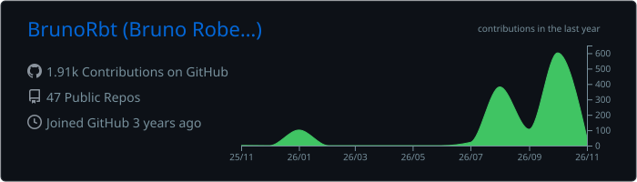
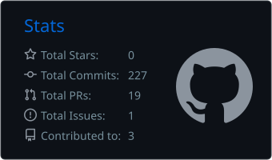
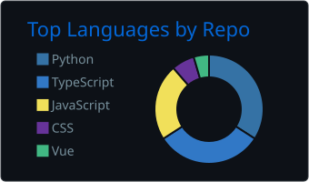
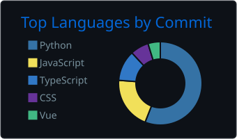
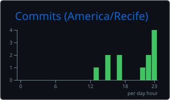

# 👨‍💻 Bruno Roberto | DevOps Developer & Desenvolvedor Full Stack

🟢 **Disponibilidade imediata** · Remoto · PJ ou CLT · 8 anos de experiência · Inglês fluente

## 🚀 Sobre Mim
Sou desenvolvedor Full Stack e DevOps com sólida experiência na criação de soluções escaláveis em nuvem, microsserviços e integração de Inteligência Artificial. Atuo de ponta a ponta construindo backends robustos em Node.js e Python, frontends modernos em React/Next.js e pipelines avançados de CI/CD em ambientes multi-cloud. Tenho histórico comprovado no desenvolvimento de sistemas que geram eficiência operacional, segurança e redução de custos.

## 💼 Experiência Profissional

### 🌐 [Autenticare](https://www.autenticare.com.br/) (Dez 2024 - Jun 2026)
**DevOps Developer | Remoto**
- Construí aplicações com Node.js e Python no backend e React/Next no frontend, com foco em performance, escalabilidade e segurança.
- Desenvolvi backends em Python (FastAPI e Flask) e Node.js integrados a LLMs (Gemini, Vertex AI, Azure OpenAI e Amazon Bedrock): saída estruturada em JSON, processamento multimodal de PDFs, imagens, áudio e vídeo, streaming e retry com backoff.
- Entreguei soluções de IA para educação e saúde: triagem de atestados médicos com encaminhamento automático (cerca de 90% menos trabalho manual), audiobooks e videoaulas gerados com Gemini e Text-to-Speech, busca semântica com Vertex AI Search (RAG) e agentes no Gemini Enterprise.
- Fiz deploy, gestão e monitoramento em ambiente multi-cloud: GCP (Cloud Run, Compute Engine, Cloud Functions, Firestore, Cloud Storage), AWS (EC2, Lambda, ECS/Fargate, S3, DynamoDB, RDS) e Azure (App Service, Functions, Container Apps, Blob Storage, Cosmos DB), com Terraform e GitHub Actions.
- Implementei arquiteturas serverless e microsserviços com mensageria (RabbitMQ) e APIs REST integradas a sistemas internos e parceiros.

### 💻 Bruno TI (Ago 2018 - Set 2024)
**Desenvolvedor Full Stack | Caruaru, PE · Remoto**
- Desenvolvi sistemas sob medida para hospitais, academias, lojistas e farmácias, com Python, Java ou Node.js no backend, React/Next no frontend e aplicativos mobile.
- Em academias, lojas e farmácias, criei soluções de ponta a ponta: sistema administrativo (estoque, compras e gestão) e plataforma do usuário final (autoatendimento e acompanhamento de treino). Em hospitais, mantive e evoluí os sistemas hospitalares.
- Estruturei APIs REST e integrações com autenticação avançada, sustentando plataformas que reduziram custos e o tempo de atendimento.

## 🚀 Projetos Destacados

### 📱 [Portfólio Pessoal](https://bruno-developer-bay.vercel.app/)
Next.js, React e TailwindCSS, multilíngue e com temas, mais assistentes de IA: chat com Gemini, analisador multimodal de documentos com streaming, agente com servidor e cliente MCP, voz em tempo real com a Gemini Live API e podcasts com TTS. Rate limiting em Redis, CSRF e validação com Zod.

### 🧾 IOCR: Validador de Documentos com IA
API que classifica e valida documentos de matrícula e atestados médicos com Gemini contra regras de negócio, com saída JSON estruturada, fallback de modelo, webhook e eventos em Cloud Logging e BigQuery, além de dashboard de métricas. Next.js/TypeScript no Cloud Run.

### 🎓 Mentor Online: tutor de IA no Canvas LMS
Tutor universitário com RAG: busca no Vertex AI Search filtrada por curso e módulo, prompt pedagógico configurável e histórico por aluno, com portal administrativo de ingestão de conteúdo (PDFs e vídeos transcritos com Speech-to-Text) e analytics. Cloud Run, PostgreSQL e Firebase Auth.

### 🤖 [Projeto Gemini Enterprise](https://drive.google.com/file/d/1wqmchuSY9zIStxcqQcHlEU5l1nvMLMWW/view?usp=sharing)
Configuração de ponta a ponta do Gemini Enterprise (Agentspace) no Google Cloud e no Microsoft Azure, com conectores (Cloud Storage, BigQuery, Google Drive, Entra ID, SharePoint, OneDrive e Outlook), agentes com tool calling e grounding em dados corporativos, e capacitação de usuários.

### 📸 [Gerenciador de Álbuns de Fotos](https://fotos-86105.web.app/)
Organização de fotos em álbuns com login (incluindo Google), upload para a nuvem, compartilhamento e notificações por e-mail. React/TypeScript no frontend e Node.js/Express com Prisma, PostgreSQL e Google Cloud Storage no backend, publicado com Docker.

### 📍 Anjo GPS
App Android de rastreamento veicular: GPS em tempo real por foreground service, geocercas, alertas de velocidade e curvas perigosas, mapas offline e telemetria via socket TCP. Kotlin, Jetpack Compose, Clean Architecture com MVVM, Hilt, Coroutines e Room.

## 🛠️ Habilidades Técnicas

### ☁️ Cloud & DevOps

-555555?style=flat-square)

### 🧠 IA Generativa

### 💻 Linguagens

### 🧰 Frameworks & Bibliotecas

### 🧪 Testes

### 🗄️ Bancos de Dados

### 🏗️ Arquitetura & Práticas

## 🎓 Formação & Certificações
- ☁️ **Certificações em IA Generativa e Agentes** | Google Cloud | 2025 - 2026
  - [Certified Partner Specialist: Gemini Enterprise Agent Development](https://drive.google.com/file/d/1um1FfTdRDEavl1b5bfeF5e0g_XmCAG14/view?usp=sharing)
  - [Certified Partner Specialist: Gemini Enterprise Deployment](https://drive.google.com/file/d/1o3DgG0LwrlHTSGLJ_ljjPBUC_2bt1qYO/view?usp=sharing)
  - [Deploy an Agent with Agent Development Kit (ADK)](https://drive.google.com/file/d/1HioGREqxKeKbTwqNs_jrJl98JiI_DqIY/view?usp=sharing)
  - [Evaluate and Improve Agent Development Kit Agents](https://drive.google.com/file/d/1utStk7fmfUMz0rXmoSt3PFsgFw_EaagT/view?usp=sharing)
  - [Govern Agent Access with Gemini Enterprise Agent Platform](https://drive.google.com/file/d/1MmG9hbhi_wRhp20uk7vKc3uNJUM1NkwA/view?usp=sharing)
  - [Deploy Gemini Enterprise with Workspace Data Sources and Model Armor](https://drive.google.com/file/d/16Ix2uX6MBz_G4iCkajmkgqUS6lHJ_bNf/view?usp=sharing)
  - [Add Agents to Gemini Enterprise](https://drive.google.com/file/d/1vHzMBTs3h_Ao-XNCRarYvfFupiP1f-De/view?usp=sharing)
  - [Extend Gemini Enterprise Assistant Capabilities](https://drive.google.com/file/d/1tt5KZyobA-uyEX_uxdhORSFVHHvS3ei_/view?usp=sharing)
  - [Deploy Google Agentspace](https://drive.google.com/file/d/1svIrFnTYeCUqtwmO8vRDo_tb7JPTVdrs/view?usp=sharing)
  - [Accelerate Development with Antigravity](https://drive.google.com/file/d/1nXtHKceLEchUj64jwSmPgWhVgtHerbv-/view?usp=sharing)
- 🖥️ **Curso Profissionalizante** | EBAC | 2023 - 2024
  - [Desenvolvedor Full Stack Python](https://drive.google.com/file/d/1l7vFWBcr2CwG957_BmEUxEf-PP7TiOok/view?usp=sharing)
  - [TI do Zero ao Pro](https://drive.google.com/file/d/1DQYk0jMalgZQQEa43l7W8NA21StFeuiz/view?usp=sharing)
  - [Plano de Carreira](https://drive.google.com/file/d/1UeBNw3sFf0v-pF6Nm4IIk0wl3WoIUq5p/view?usp=sharing)
- 🏫 **Ensino Médio** | Escola Prof. Elisete Lopes de Lima Pires | 2018

## 📊 Estatísticas GitHub

  

  
  

  
  

## 📫 Contato
- 🌐 [Portfólio](https://bruno-developer-bay.vercel.app/)
- 📧 [brunoroberto.dev8@gmail.com](https://mail.google.com/mail/?view=cm&fs=1&to=brunoroberto.dev8@gmail.com)
- 📱 [WhatsApp](https://wa.me/5581997374007?text=Oi%20Bruno!%20vim%20atrav%C3%A9s%20do%20seu%20portf%C3%B3lio)
- 💼 [LinkedIn](https://www.linkedin.com/in/bruno-roberto-devr/)

## 🌱 Atualmente Estudando
- 🤖 Agentes de IA e IA generativa em [Google Cloud](https://cloud.google.com), [Azure](https://azure.microsoft.com) e [AWS](https://aws.amazon.com)
